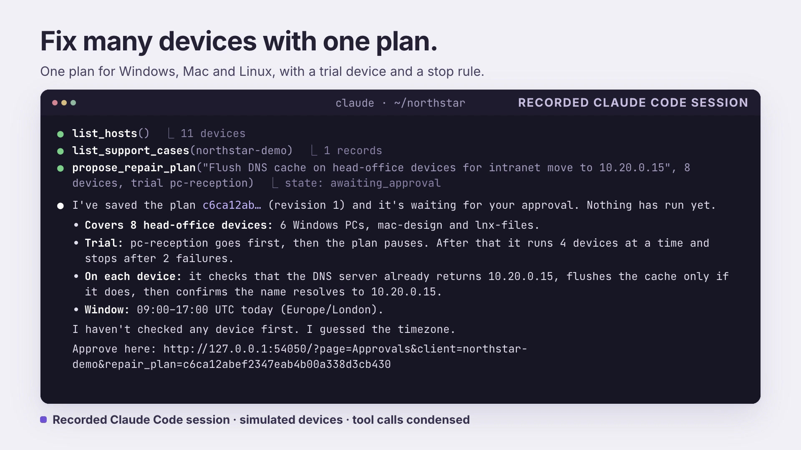
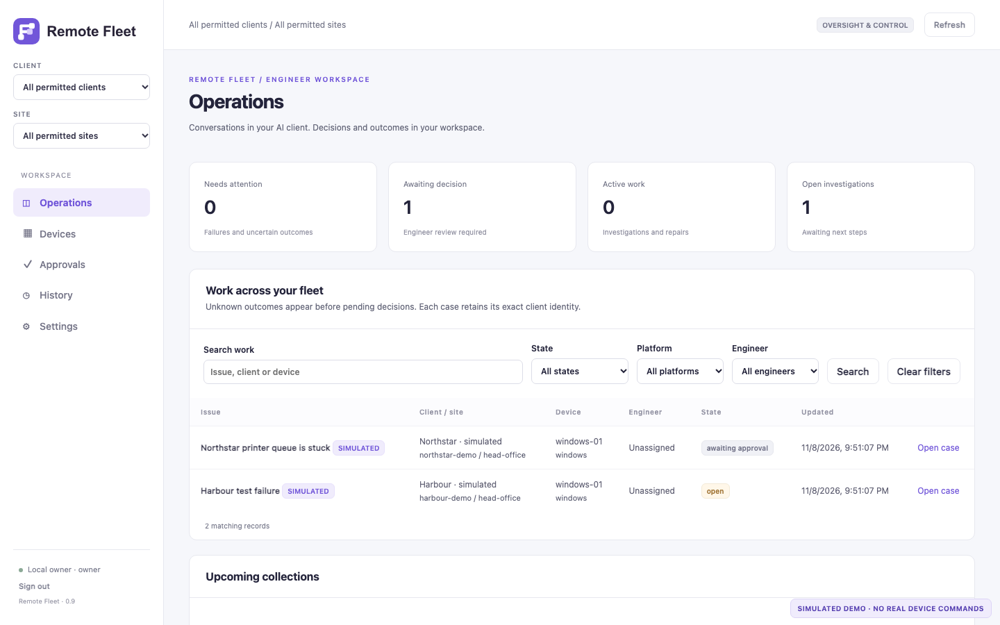
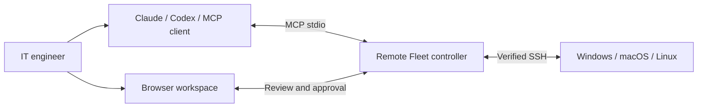
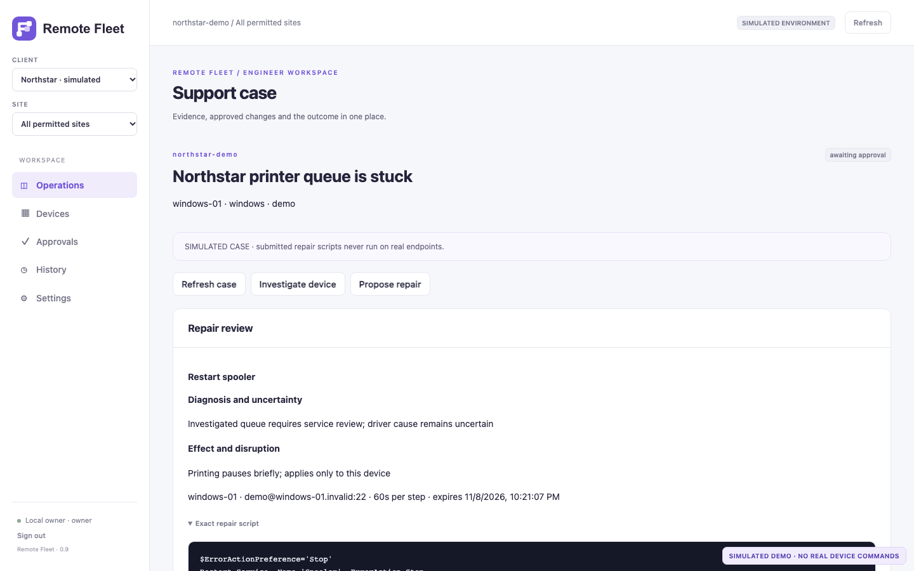

<div align="center">
  <picture>
    <source media="(prefers-color-scheme: dark)" srcset="docs/brand/remote-fleet-logo-reversed.svg">
    
  </picture>

# Remote Fleet

**AI-assisted IT support. Engineer-approved changes.**

<p>An MCP server and local operations workspace for investigating and administering<br>
Windows, macOS and Linux devices over SSH.</p>

<p>
  <a href="https://github.com/maccydee/remote-fleet-agent/actions/workflows/compatibility.yml"></a>
  <a href="https://github.com/maccydee/remote-fleet-agent/actions/workflows/secret-check.yml"></a>
  
  
</p>

[Walkthrough](#product-walkthrough) · [Quick start](#quick-start) · [AI integrations](#connect-your-ai-client) · [How it works](#how-it-works) · [Documentation](#documentation)

</div>

Describe the problem in Claude, Codex or another connected AI client. Use Remote Fleet to inspect the enrolled device, review the proposed repair, approve the exact changes and keep the result in a shared support history.

Built for **IT support engineers, managed service providers (MSPs) and internal IT teams** working across multiple clients and sites. Conversations stay in your AI client; the workspace brings attention, approvals and outcomes together.

## Product walkthrough

[](https://github.com/maccydee/remote-fleet-agent/releases/tag/showcase-v5)

**2:33 · Recorded Claude Code session · Software version 0.9.0**

[Full HD film](https://github.com/maccydee/remote-fleet-agent/releases/download/showcase-v5/remote-fleet-showcase.mp4) · [Smaller 720p preview](https://github.com/maccydee/remote-fleet-agent/releases/download/showcase-v5/remote-fleet-showcase-720p-preview.mp4) · [Captions and downloads](https://github.com/maccydee/remote-fleet-agent/releases/tag/showcase-v5)

Follow an investigation, engineer approval and a trial-first rollout across a fictional fleet. The conversation is recorded; devices and repairs are simulated. Tool calls are condensed, with simulation labels retained. [Film details and credits](docs/media/README.md).

<details>
<summary><strong>See the Operations workspace</strong></summary>



<p align="center"><sub>Actual Operations UI. Fictional clients and simulated devices; no real endpoint commands were run in these screenshots.</sub></p>

</details>

> **Development preview · 0.9.0** — The administration workflow is implemented and covered by automated tests. Native repair validation is still in progress. See [validation status](#validation-status) before using it with real devices.

## What you can do

| | Capability | What it gives the engineer |
| :---: | --- | --- |
| ◉ | **Fleet oversight** | Find work across permitted clients, sites and devices. Filter by platform, engineer or state. |
| ⌕ | **AI-assisted investigation** | Confirm named targets, run bounded PowerShell or shell diagnostics, and retain the output. |
| ✓ | **Human-approved repairs** | Review exact scripts, devices, impact and execution windows before changes are queued. |
| ⤴ | **Controlled rollouts** | Start with a trial device, pause for readiness and stop on a failed or uncertain trial. |
| ↺ | **Recovery and history** | Use approved conditional recovery steps and inspect uncertain results without automatic replay. |
| ▦ | **Inventory and evidence** | Collect inventory, diagnostics and readiness; compare snapshots and prepare client handovers. |

Device pages bring **Summary, Support history, Inventory, Evidence and Access** into one place. Existing evidence tools also cover manual appliance records, follow-ups, collection schedules and reports.

## How it works



1. **Select the device.** The engineer confirms the enrolled target, platform and account for an investigation.
2. **Investigate.** The AI gathers evidence and explains what it found, including uncertainty.
3. **Review the repair.** The plan names the devices, exact commands, checks, impact and timing. An authorised human approves that revision in the workspace.
4. **Execute and verify.** Remote Fleet records progress and technical checks. Confirmation that the affected user's problem is resolved stays separate.

A typical request might be:

> Investigate why printing is stuck on office-01. Show me the evidence and proposed changes, give me the review link, and wait for my approval before applying the repair.

This is an example support request. The project does not ship a guaranteed Outlook or printer-driver repair catalogue.

<details>
<summary><strong>See the repair review screen</strong></summary>



The screenshot shows a simulated case awaiting approval. It does not demonstrate a native printer repair.

</details>

## Quick start

Try the fictional fleet first. **No endpoint credentials or Docker required.** You need Git and Python **3.11 or newer**; install from source using the commands for your computer.

<details open>
<summary><strong>macOS / Linux</strong></summary>

```sh
git clone https://github.com/maccydee/remote-fleet-agent.git
cd remote-fleet-agent
python3 -m venv .venv
.venv/bin/python -m pip install -e .

.venv/bin/remote-fleet-agent workspace-app init --directory ./fleet-workspace
.venv/bin/remote-fleet-agent workspace-app serve --directory ./fleet-workspace --open
```

</details>

<details>
<summary><strong>Windows PowerShell</strong></summary>

```powershell
git clone https://github.com/maccydee/remote-fleet-agent.git
cd remote-fleet-agent
py -3 -m venv .venv
.\.venv\Scripts\python.exe -m pip install -e .

.\.venv\Scripts\remote-fleet-agent.exe workspace-app init --directory .\fleet-workspace
.\.venv\Scripts\remote-fleet-agent.exe workspace-app serve --directory .\fleet-workspace --open
```

</details>

The app opens locally at **http://127.0.0.1:8877**, with two fictional clients and simulated Windows, macOS and Linux devices. `--open` signs in using the private bootstrap owner token. The controller must stay running while you use the workspace.

Already have a workspace? Skip `init` and serve the existing directory. Initialization requires an empty directory.

For two actual disposable Linux SSH devices, follow the [Docker lab guide](docs/CROSS-PLATFORM-LAB.md). Those containers run Linux; the Windows and macOS simulator entries remain fictional.

## Connect your AI client

Remote Fleet uses **Model Context Protocol (MCP) over stdio**. Generated configuration formats cover:

**Claude Code · Claude Desktop · Codex · Gemini CLI · Cursor · VS Code · generic MCP clients**

The AI client handles its own model credentials. Remote Fleet needs no separate OpenAI, Anthropic or Google API key.

In **Settings → Operators**, create a dedicated **technician** operator for the AI and limit its clients and sites. Save its token in a private file outside the repository. Keep your owner or manager token for human decisions; the AI bridge refuses those approval roles.

For independent approval credentials, run the AI and controller under separate OS identities or hosts with restricted filesystem access. An AI process with the controller account's filesystem access can read that account's stored credentials.

With the workspace running, launch the support bridge using your environment's Python:

```sh
.venv/bin/python -m remote_fleet_agent.support_mcp \
  --workspace-url http://127.0.0.1:8877 \
  --operator-token-file /private/path/ai-technician-token.txt
```

On Windows, use `.\.venv\Scripts\python.exe` in place of `.venv/bin/python`.

Add `--write-configs ./support-ai-setup` to generate client snippets in an empty directory. Review and merge the relevant entry into your AI client, then reconnect it. Generation leaves existing client settings untouched.

Use the [AI support guide](docs/AI-SUPPORT.md) for setup and the [administration guide](docs/OPERATIONS-ADMINISTRATION.md) for confirmed investigations, executable plans and recovery. Provider configuration support and SDK tests are verified separately from interactive client testing.

## Working with real devices

Enrol explicitly authorised devices with verified SSH host keys. Keep the engagement's private key on the controller and define the approved accounts, hosts and access policy. Custom administration requires a separate engagement opt-in.

| Boundary | Current behaviour |
| --- | --- |
| **Target scope** | Only enrolled, approved devices; no automatic network discovery. |
| **Investigation** | Named-target confirmation, bounded output and timeouts. Custom scripts retain account privileges and can change state. |
| **Repair approval** | An engineer approves the exact plan revision. Technician API credentials cannot approve; independent credentials require OS/file-access separation. |
| **Interrupted work** | Unknown outcomes are retained and blocked from automatic replay. |
| **Cancellation** | Prevents further dispatch; it cannot undo a command already sent. |
| **Recovery** | Runs only the recovery steps and conditions in the approved plan. |
| **Hosting** | Local loopback controller; self-hosted access uses verified SSH forwarding and application login. |

Start with [deployment and enrollment](docs/DEPLOYMENT.md), [scope and access policy](docs/LIVE-WORKSPACE.md), and [credential handling](SECURITY.md). Keep operator tokens, SSH private keys, live configurations and customer evidence out of Git. The repository includes ignore rules, a local secret-check script and a full-history CI scan.

## Connect a Mac

In **Settings**, add an authorized client or select an existing real client, then choose **Create Mac connection kit**. Copy the kit to one Mac and double-click `Connect.command`. It returns the account and host key automatically; the controller verifies SSH before registering the device. Native checks work without Python. Optional private Python setup runs afterward over that verified connection.

The kit expires after 30 minutes. macOS may ask you to approve Remote Login in System Settings. See the [Mac setup guide](docs/MAC-ENROLLMENT.md) for network requirements and removing access.

## Validation status

The [**9 November 2026 GitHub matrix**](https://github.com/maccydee/remote-fleet-agent/actions/runs/42546966870) passed on Python **3.11 and 3.13**:

| Evidence | Result |
| --- | --- |
| Native Windows controller | **395 passed**, 18 skipped on each Python version |
| Native macOS controller | **400 passed**, 13 skipped on each Python version |
| Linux controller | **400 passed**, 13 skipped on each Python version |
| Chromium browser suite | **26 passed** |
| Wheel and source-distribution builds | Passed on all six OS/Python combinations |
| Windows private storage | Native NTFS permissions checked for the current account and SYSTEM |
| Windows scratch scripts | Local PowerShell repair, recovery, cleanup and sentinel guards passed |
| Windows endpoint and two Linux Docker endpoints | Earlier pinned SSH read-only checks completed |
| Full native repair workflow across enrolled targets | Still pending separate enrollment and human approvals |
| Native macOS target | SSH prerequisite unavailable in the test environment |
| Interactive AI-client workflows | Not yet verified in each provider application |

Windows skips include POSIX-only local execution tests and the opt-in native endpoint tests. macOS/Linux skips include Windows-only local execution tests and those same endpoint gates. All platforms retain remote command-construction checks. Local scratch tests exercise generated scripts; they do not establish a full approved repair over SSH.

The badges at the top show the current CI results. See [release evidence and remaining gates](docs/SUPPORT-RELEASE-GATES.md) for the limits; a container test does not establish native GUI, systemd or physical-device behaviour.

## Documentation

| Guide | Start here for |
| --- | --- |
| [Operations and administration](docs/OPERATIONS-ADMINISTRATION.md) | Confirmed investigations, repair plans, rollout controls and recovery |
| [Local workspace](docs/LIVE-WORKSPACE.md) | Clients, sites, roles, operator tokens and scheduling |
| [AI support](docs/AI-SUPPORT.md) | Connecting an AI client and reviewing support cases |
| [AI and host compatibility](docs/AI-AND-HOST-COMPATIBILITY.md) | Provider formats and Windows, macOS and Linux controllers |
| [Deployment](docs/DEPLOYMENT.md) | Windows assessment kit, enrollment and cleanup |
| [Cross-platform lab](docs/CROSS-PLATFORM-LAB.md) | Simulated devices and two disposable Linux SSH endpoints |
| [Fleet collection](docs/FLEET-WORKFLOW.md) | Inventory, diagnostics, readiness and terminal jobs |
| [Evidence and reporting](docs/OPERATIONS-WORKFLOW.md) | Comparisons, manual records, reports and retention |
| [Credential handling](SECURITY.md) | Keeping secrets and customer data out of source control |

## Development

```sh
.venv/bin/python -m pip install -e '.[dev,browser]'
.venv/bin/python -m pytest -q --ignore=tests/browser
.venv/bin/python -m playwright install chromium
.venv/bin/python -m pytest tests/browser -q
.venv/bin/python -m ruff check src tests
```

On Windows, use `.\.venv\Scripts\python.exe` in place of `.venv/bin/python`. Native tests require an explicit opt-in, private manifest and separate human approval; see [native support testing](docs/NATIVE-SUPPORT-TESTING.md). Review staged changes with `sh scripts/check-secrets.sh` before committing; it requires Gitleaks.

**Licence:** not yet specified.
